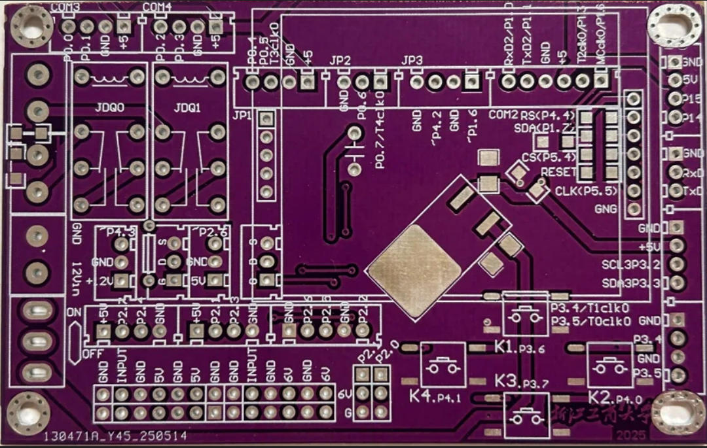
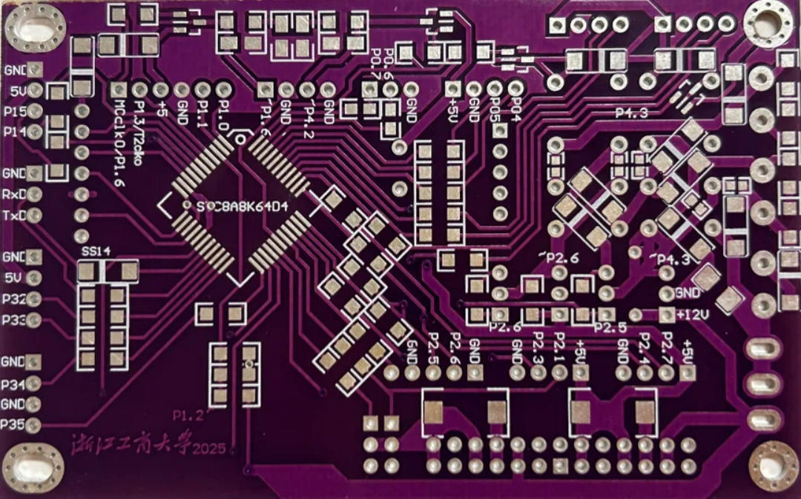
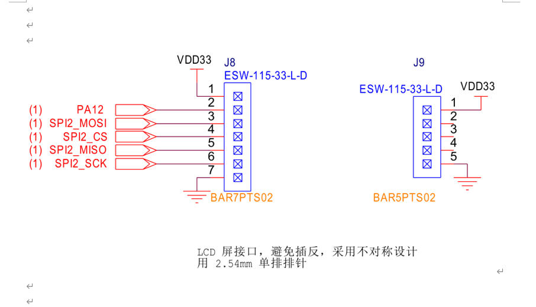
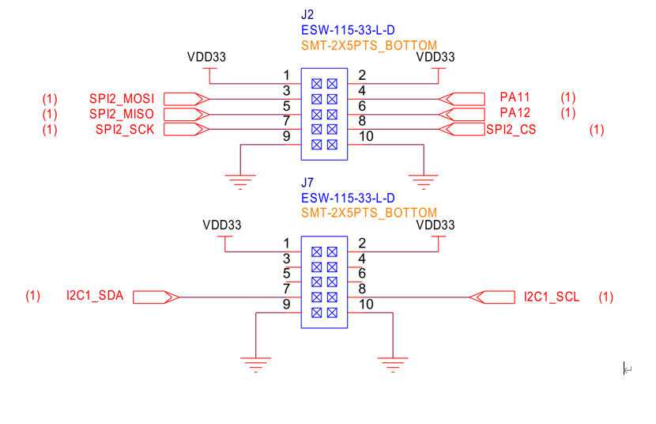

# 🤖 Traction Control 

## 📌 Project Overview
This project focuses on autonomous navigation and hardware control using an **STC8A8K64D4**-based custom line-tracking car. The goal was to implement boundary detection, PID speed-distance control, and robust line-tracking through 9-channel infrared detection module.

<!-- 插入成品车照片 -->

### 🛠️ Tech Stack
*   **Languages:** C / C++
*   **Platforms:** STC8A8K64D4 (8051 MCU)
*   **Hardware Design:** Custom PCB Design, Power Circuit (TPS5430DA)
*   **Sensors & Actuators:** Infrared (IR) sensors, Proximity sensors, PWM motor control

---

## 💡 My Core Contributions
*   **Hardware & Circuit Design:** contribute to the custom PCB layout design and schematics.
*   **Autonomous Line Tracking:** Developed self-learning PID control logic using infrared sensor arrays to detect black/white contrast, enabling dynamic speed adjustment and successful clockwise and counter clockwise turns.
*   **9-channel Infrared Detection Broad:** Co-developed and imporve 9-channel *black & white* detection board using infrared sensor input, participating in the circuit soldering process.

---

## 🐛 Engineering Troubleshooting & Error Analysis
*Real engineering is about solving unexpected problems across hardware and software.*

*   **Environmental Light Interference:** IR sensors occasionally misjudged the track under strong ambient light. I implemented a *"majority vote" logic* and *Lookup table(LUT)* method in the code to filter out noisy signals and quick response, significantly improving stability and speed.
*   **Mechanical & Control Errors:** To address mechanical gaps and inconsistent motor speeds during sharp turns, I tuned the PWM duty cycle differential between the left and right wheels to ensure fast and accurate trajectory correction.
*   **Sensor Measurement Inaccuracies:** For the STC8A8K64D4 car, the proximity sensor fitting was distorted over certain ranges. We optimized the system by using raw sensor readings at target distances, achieving steady line-following behavior.

---
## 🖼️ Hardware Gallery
*(Custom STC8A8K64D4 Main Control Board Design)*

**1. PCB Routing & Layout**
| Top Layer Routing | Bottom Layer Routing |
| :---: | :---: |
|  |  |

**2. Schematic Design (Interface & Communication)**
*(Note: The LCD interface uses an asymmetric pin design to prevent reverse insertion.)*

| LCD Interface Schematic | SPI & I2C Bus Assignment |
| :---: | :---: |
|  |  |

## 🏆 Results & Achievements
*   Successfully achieved smooth line-tracting behavior through self-learning PID control on the custom-built car.
*   Designed and validated the complete hardware schematic, PCB layout, and embedded control logic.

---

## 🙏 Acknowledgements
*   **Course Instructors:** *Mr. Zhu* at *Zhejing Gongshang University*, for providing the hardware platform and lab testing environment.
*   **Project Teammates:** *Miss Yu & Mr Shi*, for their collaboration in testing and hardware debugging.

---
*Maintained by FishInCode.*
