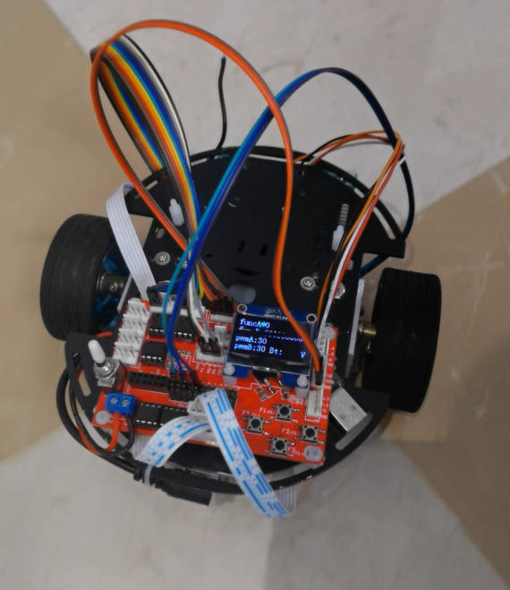

# 🤖 Micro-Robot Navigation & Embedded Control

## 📌 Project Overview
This project focuses on autonomous navigation and hardware control using an **STC8A8K64D4**-based custom line-tracking car and the **Elisa-3** micro-robot platform. The goal was to implement boundary detection, PID wall-distance control, and robust line-tracking through sharp right-angle turns.

<!-- 插入成品车照片 -->

### 🛠️ Tech Stack
*   **Languages:** C / C++
*   **Platforms:** STC8A8K64D4 (8051 MCU), Elisa-3
*   **Hardware Design:** Custom PCB Design, Power Circuit (TPS5430DA)
*   **Sensors & Actuators:** Infrared (IR) sensors, Proximity sensors, PWM motor control

---

## 💡 My Core Contributions
*   **Hardware & Circuit Design:** Independently designed the custom PCB layout and schematics. Implemented a fool-proof asymmetric pin design for the LCD interface to prevent reverse insertion during assembly.
*   **Autonomous Line Tracking:** Developed control logic using infrared sensor arrays to detect black/white contrast, enabling dynamic speed adjustment and successful right-angle turns.
*   **State-Machine Navigation (Elisa-3):** Co-developed corridor navigation using sensor inputs, route counters, and state flags to track the robot's status.

---

## 🐛 Engineering Troubleshooting & Error Analysis
*Real engineering is about solving unexpected problems across hardware and software.*

*   **Environmental Light Interference:** IR sensors occasionally misjudged the track under strong ambient light. I implemented a "majority vote" logic in the code to filter out noisy signals, significantly improving stability.
*   **Mechanical & Control Errors:** To address mechanical gaps and inconsistent motor speeds during right-angle turns, I tuned the PWM duty cycle differential between the left and right wheels to ensure fast and accurate trajectory correction.
*   **Sensor Measurement Inaccuracies:** For the Elisa-3 robot, the proximity sensor fitting was distorted over certain ranges. We optimized the system by using raw sensor readings at target distances, achieving steady wall-following behavior.

---
## 🖼️ Hardware Gallery
*(Custom STC8A8K64D4 Main Control Board Design)*

**1. PCB Routing & Layout**
| Top Layer Routing | Bottom Layer Routing |
| :---: | :---: |
|  |  |

**2. Schematic Design (Interface & Communication)**
*(Note: The LCD interface uses an asymmetric pin design to prevent reverse insertion.)*

| LCD Interface Schematic | SPI & I2C Bus Assignment |
| :---: | :---: |
|  |  |

## 🏆 Results & Achievements
*   Successfully met the challenge of navigating through sharp right-angle turns with the custom-built car.
*   Designed and validated the complete hardware schematic, PCB layout, and embedded control logic.

---

## 🙏 Acknowledgements
*   **Course Instructors:** [Dr.Bao Kha Nguyen] at [University of Sussex], for providing the hardware platform and lab testing environment.
*   **Project Teammates:** [Miss Jing & Mr Yang], for their collaboration in testing and hardware debugging.

---
*Maintained by FishInCode.*
